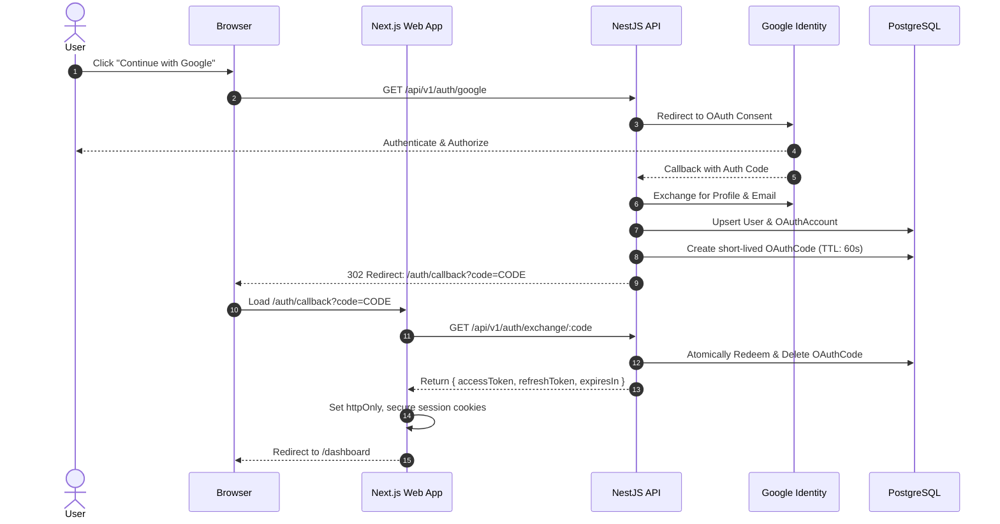
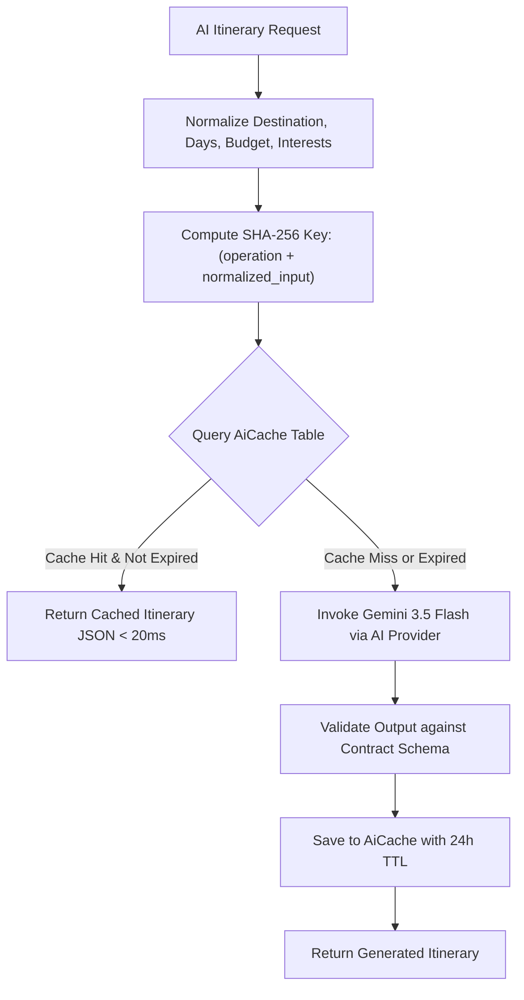
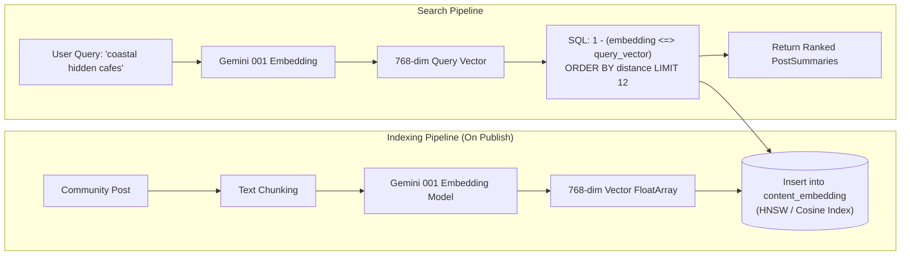
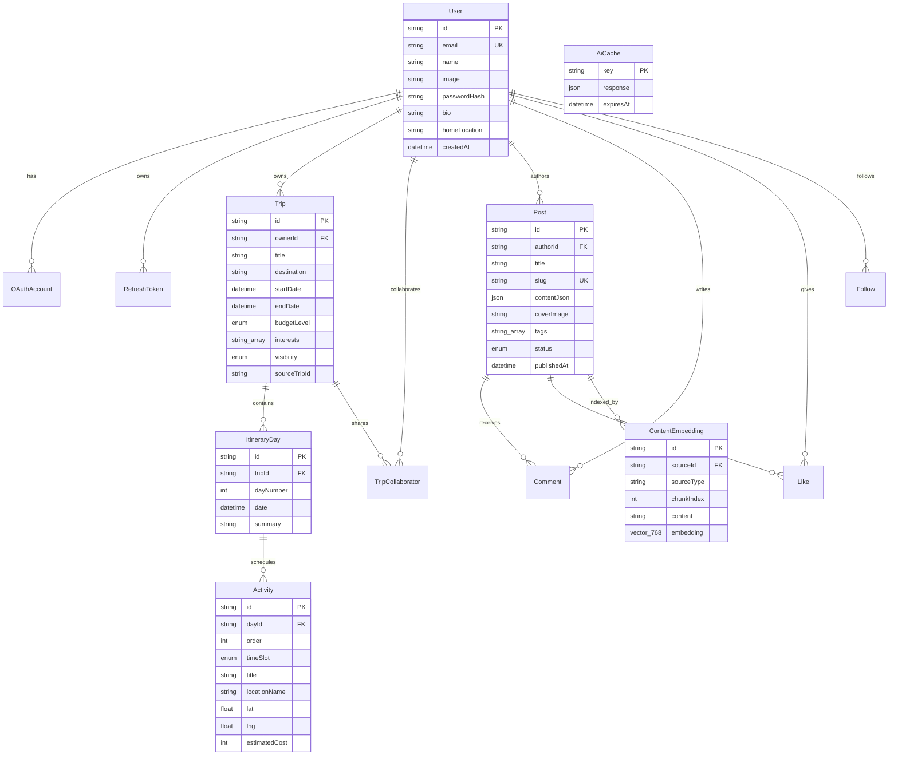

# High-Level Design (HLD): Travel Companion Platform

> **System Overview**: An end-to-end, AI-powered travel planning, collaboration, and community platform built with a high-performance modern TypeScript monorepo architecture.

---

## 1. Executive Summary & Problem Statement

Modern travelers face fragmented workflows: research happens on social blogs, itinerary planning in spreadsheets or static note apps, and recommendations from generic search engines that lack context.

**Travel Companion** bridges this gap by unifying:
1. **Intelligent Trip Planning**: Multi-day itinerary generation with slot-based scheduling (morning/afternoon/evening), budget tracking, and geolocation.
2. **Semantic Search & Discovery**: Vector-based semantic search powered by `pgvector` and LLM embeddings, allowing travelers to search by natural language intent (e.g., *"quiet coastal road trip with hidden cafes"*).
3. **Collaborative Workspaces**: Multi-user permissions (Owner, Editor, Viewer) for co-planning trips with friends.
4. **Rich Social Storytelling**: Community blog posts, linked trip itineraries, follow graphs, and engagement metrics.
5. **Cost-Optimized AI Engine**: Integration with Google Gemini (`gemini-3.5-flash-lite`, `gemini-embedding-001`) with deterministic SHA-256 prompt response caching to prevent duplicate LLM calls and control operating costs.

---

## 2. Requirements & System Constraints

### 2.1 Functional Requirements
- **Authentication & Identity**: Dual-mode auth supporting Argon2id password hashing and Google OAuth 2.0 via a secure, one-time code exchange pattern.
- **Trip & Itinerary Management**: CRUD for trips, automated multi-day structuring, activity ordering, budget categorization, and trip cloning/forking.
- **AI Travel Assistant**: Prompt-to-itinerary synthesis, budget suggestions, and contextual travel recommendations.
- **Semantic Content Discovery**: High-dimensional vector search across published community travel logs.
- **Social Graph & Engagement**: Follow/unfollow travelers, like stories, comment threads, and user public profiles.

### 2.2 Non-Functional Requirements & Design Targets
- **Performance**: P95 API latency < 150ms for relational queries; < 300ms for vector similarity searches; sub-second Next.js SSR page hydration.
- **Cost Efficiency**: Deterministic AI caching layer targeting a > 40% cache hit rate for common planning queries.
- **Type Safety & Maintainability**: 100% end-to-end type safety from database schema (Prisma) to runtime boundary validation (Zod) to UI React components.
- **High Availability & Scalability**: Stateless API tier horizontally scalable behind a load balancer; PostgreSQL with read-replica capability.
- **Security**: Strict CORS policies, JWT rotation, Argon2id password hashing, and zero token exposure in browser URLs.

---

## 3. High-Level Architecture

The platform follows a **Clean Architecture / Modular Monolith** pattern organized as a `pnpm` workspace monorepo.

```mermaid
graph TB
    subgraph ClientTier["Client Tier (apps/web)"]
        Browser["Desktop & Mobile Browsers"]
        NextServer["Next.js 16 App Router<br/>(Server Components & Server Actions)"]
        ClientHooks["Client Components<br/>(useSyncExternalStore, UI State)"]
    end

    subgraph GatewayTier["API Tier (apps/api)"]
        NestApp["NestJS 10 Core Application"]
        GuardPipes["Auth Guards & Zod Validation Pipes"]
        subgraph FeatureModules["Feature Modules"]
            AuthMod["AuthModule (JWT & OAuth)"]
            TripsMod["TripsModule (Planning & Collab)"]
            PostsMod["PostsModule (Content & Markdown)"]
            DiscoverMod["DiscoveryModule (pgvector Search)"]
            AiMod["AiModule (Gemini & Cache)"]
            SocialMod["SocialModule (Follows, Likes, Comments)"]
        end
    end

    subgraph DataTier["Data & Storage Tier"]
        PG[("PostgreSQL 16")]
        PGV[("pgvector Extension<br/>768-dim Embeddings")]
        Cloudinary["Cloudinary CDN<br/>(Media & Post Covers)"]
    end

    subgraph ExternalServices["External AI Services"]
        GeminiFlash["Google Gemini 3.5 Flash"]
        GeminiEmbed["Gemini Embedding 001"]
    end

    Browser <--> NextServer
    NextServer <--> ClientHooks
    NextServer <-->|REST / JSON (Internal/Public)| GuardPipes
    GuardPipes --> NestApp
    NestApp --> FeatureModules

    AuthMod --> PG
    TripsMod --> PG
    PostsMod --> PG
    PostsMod --> Cloudinary
    DiscoverMod --> PGV
    SocialMod --> PG

    AiMod -->|Semantic Embedding| GeminiEmbed
    AiMod -->|Itinerary Generation| GeminiFlash
    AiMod -->|Embedding Storage| PGV
    AiMod -->|SHA256 Response Cache| PG
```

### Monorepo Structure
```
travel-companion/
├── apps/
│   ├── api/                 # NestJS 10 Modular Monolith REST API
│   │   ├── prisma/          # Prisma schema, migrations, pgvector config
│   │   └── src/             # Auth, Trips, Posts, Discovery, AI, Social
│   └── web/                 # Next.js 16 (Turbopack, App Router, React 19)
│       ├── src/app/         # (app) workspace & (marketing) public routes
│       ├── src/components/  # Layout, AppShell, Trips, Posts, Auth
│       └── src/lib/         # Server Actions, API clients, session management
├── packages/
│   └── contracts/           # Shared Zod schemas, TypeScript types, Enums
├── docker-compose.yml       # Local PostgreSQL + pgvector container
└── package.json             # Root pnpm workspaces configuration
```

---

## 4. Key Architectural Subsystems & Deep Dives

### 4.1 Shared Contracts (`packages/contracts`)
To prevent drift between backend DTOs and frontend forms, the platform uses a dedicated **Contracts** package:
- **Zod Schemas**: Single source of truth for runtime validation (e.g., `loginRequestSchema`, `createTripSchema`, `discoveryQuerySchema`).
- **Inferred Types**: TypeScript types automatically inferred via `z.infer<typeof schema>`.
- **Validation Pipes**: NestJS uses `ZodValidationPipe` to reject malformed requests at the network boundary before reaching service layers.

---

### 4.2 Secure Authentication Flow (One-Time Code Exchange)
Standard OAuth flows that redirect back to the frontend with access tokens in query params (`?token=...`) leak credentials into browser history, referrer headers, and server access logs. 

Travel Companion implements a **One-Time Code Exchange Pattern**:



---

### 4.3 AI Engine & Deterministic Response Caching

Calling Generative AI models for every trip query introduces high latency (2–5s) and linear API cost growth. The `AiModule` incorporates a deterministic cache layer:



- **Pluggable Providers**: Implements the Strategy pattern (`AiProvider` interface) supporting:
  - `GeminiProvider`: Google Generative AI SDK with structured JSON schemas.
  - `MockAiProvider`: Deterministic offline mock for CI/CD and local development without external API keys.

---

### 4.4 Semantic Search & Vector Discovery (`pgvector`)

Instead of maintaining a separate vector database (like Pinecone or Qdrant) which adds network latency, operational overhead, and dual-write consistency issues, Travel Companion uses **PostgreSQL with `pgvector`**:



**Why `pgvector` over dedicated Vector DBs? (Interview Talking Point)**:
1. **Transactional Integrity**: Embeddings are inserted and deleted in the exact same database transaction as the blog post. No orphan vectors if a post is deleted.
2. **Hybrid Queries**: Allows combining relational filters (`WHERE status = 'PUBLISHED' AND author_id != x`) with vector cosine similarity in a single query.
3. **Operational Simplicity**: Single backup/restore, single connection pool, and zero extra infrastructure cost.

---

## 5. Data Architecture & Entity Relationship Diagram

The database uses PostgreSQL with relational integrity, foreign key cascades, and targeted composite indexes.



---

## 6. Frontend Architecture (`apps/web`)

### 6.1 Server Components vs. Client Components
- **Server Components (RSC)**: Used for data fetching (`/dashboard`, `/trips`, `/posts`, `/discover`). Fetches directly from the internal API with cookie forwarding, eliminating client-side loading spinners and providing fast SEO-ready HTML.
- **Server Actions**: Used for mutations (`loginAction`, `registerAction`, `logoutAction`). Handles session cookie creation with `httpOnly` and `sameSite: 'lax'`.
- **Client Components**: Isolated to interactive UI widgets:
  - `AppShell`: Persistent collapsible navigation with zero hydration mismatch via `useSyncExternalStore`.
  - `UserNav`: Floating profile popover with solid opacity, keyboard traps, and click-outside dismissal.
  - `ItineraryEditor`: Drag-and-drop / slot-based day planner.

### 6.2 Hydration & External Store Architecture
To support persistent user preferences (e.g., sidebar collapsed state in `localStorage`) without causing React SSR hydration mismatches, the app utilizes `useSyncExternalStore`:
- **Server Snapshot**: Returns `false` deterministically.
- **Client Snapshot**: Reads `localStorage.getItem('tc_sidebar_collapsed')`.
- **Sync**: Re-renders client-side immediately after initial hydration without triggering React 19's `react-hooks/set-state-in-effect` rule.

---

## 7. Security, Resilience & Scalability Patterns

| Category | Implementation Strategy |
| :--- | :--- |
| **Password Security** | `argon2id` (memory-hard, resistant to GPU/ASIC cracking) with constant-time verification. |
| **Session Security** | Short-lived Access JWTs (15 min) + Long-lived Refresh Tokens (30 days) stored as hashes in DB with rotation. |
| **Token Safety** | OAuth credentials never pass through URL fragments or query parameters; exchanged via short-lived, single-use `OAuthCode`. |
| **API Boundary Validation** | Strict `ZodValidationPipe` stripping extraneous properties and rejecting invalid payloads. |
| **AI Abuse Prevention** | Per-user rate limiting (sliding window) + SHA-256 prompt hashing for cache deduplication. |
| **Network Security** | Strict CORS whitelisting, HTTP Security headers, and internal container communication. |

---

## 8. Senior Full Stack Interview Deep Dives

### Question 1: How do you handle schema evolution and contract synchronization in this architecture?
> **Answer**: By creating a shared `@travel-companion/contracts` workspace package, both the NestJS API and Next.js frontend import the exact same Zod validation schemas. When a field is added to a contract, TypeScript compiler flags errors across both frontend forms and backend controllers before code can even be committed. Runtime validation ensures client requests match the contract, while build-time types ensure developer ergonomics.

### Question 2: Why choose `pgvector` inside PostgreSQL instead of a specialized vector database like Pinecone?
> **Answer**: At our scale, a specialized vector database introduces distributed system complexity: network latency, cost, and most critically, **dual-write consistency**. In a specialized store, if a user updates or deletes a trip/post, you must write two-phase commit logic to delete the vector. In PostgreSQL with `pgvector`, embedding rows share the same transaction boundary. If the post creation fails or is rolled back, the embedding rolls back automatically. Furthermore, hybrid queries combining relational metadata (`authorId`, `publishedAt`, `visibility`) with vector distance calculations run in a single optimized query plan.

### Question 3: How does the application avoid React Hydration Mismatch with client-persisted storage?
> **Answer**: Hydration mismatch occurs when the server-rendered HTML differs from the initial client render tree (for example, reading `window.localStorage` inside `useState`). To solve this cleanly without disabling SSR or causing layout shift, we implement React's `useSyncExternalStore` hook. By providing a static `getServerSnapshot` that matches the server output and subscribing to `localStorage` and custom window events via `getSnapshot`, React guarantees a 100% matched initial hydration, followed immediately by an atomic client update.

### Question 4: How is the AI layer architected to prevent API rate limits and cost spikes?
> **Answer**: We designed a 3-layer protection model:
> 1. **Deterministic SHA-256 Prompt Caching**: Input parameters (destination, duration, budget, interests) are normalized, sorted, and hashed into a deterministic key. Repeated queries hit `AiCache` with sub-20ms latency and 0 token cost.
> 2. **Provider Abstraction**: A strategy pattern decouples business logic from Google Gemini, allowing transparent fallback to alternative LLMs or mock providers.
> 3. **Structured Outputs**: We enforce JSON schema output mode so responses never require complex, error-prone regex parsing or secondary retry calls.

---

## 9. Future Roadmap & Scaling Strategy
1. **Real-Time Collaboration**: Transition itinerary editing from REST to WebSocket/CRDTs (Yjs) for Google Docs-style concurrent multi-user editing.
2. **Background Jobs & Message Queue**: Integrate BullMQ + Redis for asynchronous image optimization, embedding generation, and weekly digest emails.
3. **Edge Caching**: Deploy Cloudflare CDN or Vercel Edge caching on `/api/v1/discover` public feeds with stale-while-revalidate headers.
